  
  ·
  
  ·
  
  ·
  
  ·
  

 

  

<a href="#نبذة">نبذة</a> · <a href="#ما-أبنيه">ما أبنيه</a> · <a href="#التقنيات">التقنيات</a> · <a href="#الأرقام">الأرقام</a> · <a href="#خطة-العمل">خطة العمل</a> · <a href="#تواصل">تواصل</a>

---

## نبذة

  
   
  JONIS.AI — النواة التشغيلية

**JONIS.AI** هو مركز الهندسة الخاص بـ **Jony Peixoto**، مؤسس **CyberTimeUP**. هنا تلتقي الهوية والمنتجات والتجارب: **الذكاء الاصطناعي التطبيقي**، **الويب ثلاثي الأبعاد**، و**منتجات XaaS**.

> نبني حيث يلتقي الذكاء بالهندسة.

  

**التركيز:** `ذكاء تطبيقي` · `3D غامر` · `منتجات قابلة للتوسع` · `هوس بالتفاصيل`

---

## ما أبنيه

<strong>01 · AI Engineering</strong> — وكلاء وأتمتة وتطبيقات LLM

 

من النموذج الأولي إلى الإنتاج: وكلاء وRAG وصوت وتكاملات وخطوط معالجة تقلل العمل اليدوي وتزيد الإيرادات.

`وكلاء` `RAG` `أتمتة` `صوت` `APIs` `ضبط دقيق`

<strong>02 · 3D Sites</strong> — ويب غامر بأداء بمستوى المنتجات

 

WebGL وThree.js والتظليل (shaders) وحركة مدروسة. غمر بصري عالي التأثير دون التضحية بالسرعة أو إمكانية الوصول أو التحويل.

`Three.js` `WebGL` `GLSL` `Motion` `أداء` `60fps`

<strong>03 · XaaS</strong> — منصات ومنتجات بنظام الاشتراك

 

من الهندسة المعمارية إلى الفوترة، ومن التهيئة الأولى إلى لوحة التحكم. برمجيات كخدمة مصممة للتوسع بشكل متوقع.

`SaaS` `منصات` `فوترة` `لوحات تحكم` `بنية تحتية` `توسع`

---

## التقنيات

 

 

---

## الأرقام

 

 

<strong>ثعبان المساهمات</strong> — يُنشأ تلقائيًا بواسطة workflow

 

يتم إنشاء الرسوم المتحركة بواسطة سير العمل [`snake.yml`](.github/workflows/snake.yml) ونشرها في فرع `output`. تظهر بعد أول تشغيل لـ Action.

  

---

## خطة العمل

- [x] الهوية البصرية لـ JONIS.AI
- [x] README تفاعلي متحرك
- [ ] أول مشاريع مفتوحة المصدر
- [ ] مختبر تجارب 3D
- [ ] فتح Discussions

---

## تواصل

| القناة | المكان |
| --- | --- |
| GitHub | [@jonypeixoto](https://github.com/jonypeixoto) |
| المؤسسة | [JONIS-AI](https://github.com/JONIS-AI) |
| المحادثة | [فتح issue](https://github.com/JONIS-AI/JONIS.AI/issues) |

© 2026 JONIS.AI — صُنع بهوس بالتفاصيل.

