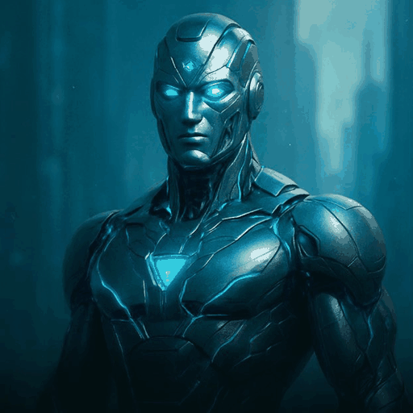

<p align="center">
  <a href="README.en-GB.md" title="English (UK)"></a>
  ·
  <a href="README.md" title="English (US)"></a>
  ·
  <a href="README.pt-BR.md" title="Português"></a>
  ·
  <a href="README.ru.md" title="Русский"></a>
  ·
  <a href="README.zh-CN.md" title="中文"></a>
  ·
  <a href="README.ar.md" title="العربية"></a>
</p>

<div align="center">


# JONIS.AI
### Your digital butler, upgraded.
**Autonomous. Model-agnostic. Open-source. Free to run locally.**

An open-source autonomous digital butler — a JARVIS, upgraded — designed to perform real tasks on your system, with optional 3D/HUD presence and two-way voice. Run free local models with Ollama or bring your own Claude, Gemini and OpenAI/Codex API keys.

<a href="LICENSE"></a>
<a href="https://github.com/JONIS-AI/JONIS.AI/pulls"></a>
<a href="#local-vs-cloud-api"></a>
<a href="#model-engines"></a>

<br/>

<a href="https://github.com/JONIS-AI"></a>


<br/><br/>

<a href="#a-digital-butler-built-to-serve-and-act">About</a> · <a href="#local-vs-cloud-api">Local vs Cloud</a> · <a href="#demo-and-experience">Demo</a> · <a href="#what-jonis-does-for-you">Capabilities</a> · <a href="#-butler-modules-and-capabilities">Modules</a> · <a href="#obsidian-second-brain">Obsidian</a> · <a href="#model-engines">Engines</a> · <a href="#-quick-start">Quick Start</a> · <a href="#-roadmap">Roadmap</a> · <a href="#-faq">FAQ</a>

</div>

---

## A Digital Butler Built to Serve and Act

Most AI tools wait for your next prompt. **JONIS.AI** is being built as a digital butler with presence, voice and bounded autonomy: it reads your context, takes initiative within rules you define, switches "brains" to fit the task and carries out concrete actions in your environment.

- **Free and open-source:** MIT-licensed software with no subscription or provider lock-in. Local mode has no API fees.
- **Switch LLMs in seconds:** start with free local models through **Ollama**, or connect **Claude, Gemini, OpenAI/Codex, OpenRouter** and compatible engines with your own keys.
- **Voice and visual presence:** text-first by design, with two-way voice and an optional 3D avatar/HUD on the roadmap.
- **You set the boundaries:** allowlists, confirmation for sensitive actions and a local audit trail are core design principles.

> Your vault. Your rules. Your choice of intelligence.

**Project status:** the product is in development. This repository currently holds the vision, architecture, visual identity and roadmap; the executable capabilities below describe the intended product.

---

## Local vs Cloud API

Choose how your butler operates based on your hardware, budget and privacy needs.

| Criterion | Local Mode | Cloud / BYOK Mode |
| :--- | :--- | :--- |
| **Cost** | **€0 / R$0 in API fees** — only hardware and electricity | Provider pricing or free tier; you bring your own key |
| **Privacy** | **Maximum** — data is processed on your machine | Selected context is sent to the chosen LLM provider |
| **Requirements** | Reasonable CPU/GPU and [Ollama](https://ollama.com/) installed | Internet connection and a valid API key |
| **Example models** | `qwen2.5-coder`, `llama`, `deepseek` | Claude, Gemini, OpenAI/Codex, OpenRouter |
| **Best for** | Continuous use, offline work and sensitive data | Complex reasoning, long context and workload spikes |

Cloud free tiers and quotas can change, and API usage may incur costs. No paid provider is required to use the planned local mode.

---

## Demo and Experience

<div align="center">
  
  <br/>
  <sub>JONIS.AI — visual core</sub>
</div>

<br/>

<div align="center">
  
</div>

The sequence below illustrates the intended end-to-end workflow.

```text
[JONIS.AI — target workflow]
> "Switch to the free local model, organise the reports in /finance and create a summary."

[Engine: ollama/qwen2.5-coder:7b | Voice: ready | Policy: confirm writes]
> 14 reports classified
> Summary saved to /finance/monthly-summary.md
```

---

## What JONIS Does for You

<details>
<summary><strong>01 · Context and initiative</strong> — understand the vault and propose the next useful action</summary>

<br/>

Combines active notes, tasks and recent activity into a working context. It can suggest the next step, draft a plan and ask before acting when the request is ambiguous.

`Context` `Planning` `Proactive prompts` `Human review`

</details>

<details>
<summary><strong>02 · Real execution with guardrails</strong> — turn intent into concrete system actions</summary>

<br/>

Designed to organise files, create structured notes, run approved workflows and call authorised tools. Sensitive operations require explicit approval, and every action is recorded locally.

`Tool use` `Allowlists` `Approvals` `Audit log`

</details>

<details>
<summary><strong>03 · Model routing</strong> — use the right engine without provider lock-in</summary>

<br/>

A provider-agnostic router selects between local and cloud engines by task, cost, privacy and availability. Paid cloud access is always opt-in; the router must not silently send vault data to a cloud API.

`Ollama` `BYOK` `Fallback` `Cost control`

</details>

<details>
<summary><strong>04 · Voice and visual presence</strong> — interact beyond plain text</summary>

<br/>

A terminal-first experience keeps the core accessible, while bidirectional voice and an optional holographic 3D/HUD avatar add a more immersive layer.

`Two-way voice` `3D avatar` `HUD` `Accessibility`

</details>

---

## 🧩 Butler Modules and Capabilities

The planned modular core brings together six practical layers:

- **💻 Execution & Coding:** Creates structures, runs commands, debugs errors, reads logs and supports development workflows.
- **🎙️ Two-Way Voice:** Speak naturally with the butler and receive responses as audio or text.
- **🌐 Holographic 3D Face / HUD Interface:** An optional visual layer that gives the butler an identity and real-time state feedback.
- **📂 File & Data Management:** Reads documents, organises folders, extracts information and prepares structured deliverables.
- **🔎 Research & Synthesis:** Cross-references information and summarises what matters without wasting time.
- **🔌 Extensible Architecture:** Add new skills, tools and connectors to fit your workflow.

---

## Obsidian Second Brain

The plugin is designed for desktop, tablet and mobile and works with the **free plan**. Obsidian Sync and Obsidian Publish are not required.

- **Markdown is the source of truth:** your notes stay readable, portable and under your control.
- **Local-first retrieval:** SQLite/FTS and optional local embeddings power search and cited answers.
- **A practical workflow:** capture, classify, link, retrieve, act and review.
- **Optional storage and connectors:** 9Drive, Notion and Miro extend the system without becoming dependencies.

```text
Capture -> Classify -> Link -> Retrieve -> Act -> Review
   |          |         |          |       |       |
 vault      local      wiki     local index  tools   audit
 notes      rules      links                  trail
```

| Integration | Planned role | Required? |
| :--- | :--- | :--- |
| **Obsidian** | Vault, notes, tasks and plugin interface | Yes |
| **[9Drive](https://github.com/zenhosta/9drive)** | Attachments, exports and backup routing through a storage-provider interface | No |
| **Notion** | Optional page and database import/sync connector | No |
| **Miro** | Optional board import connector | No |

Local storage remains the default. The second brain must remain useful even when every optional connector is disabled.

---

## Model Engines

The Agent Harness currently supports local Ollama and OpenAI-compatible endpoints on desktop, tablet and mobile. Lite, Balanced and Full profiles select smaller or larger local defaults; cloud endpoints require HTTPS, whilst private LAN HTTP for Ollama must be explicitly enabled. The broader adapter roadmap keeps the agent independent of any single model vendor.

| Engine | Mode | Intended role |
| :--- | :--- | :--- |
| **Ollama** | Local | Default free/offline path |
| **OpenAI-compatible endpoints** | Local or self-hosted | Flexible local and private deployments |
| **Claude** | Cloud / BYOK | Complex reasoning and long-form work |
| **Gemini** | Cloud / BYOK | Long context and multimodal tasks |
| **OpenAI / Codex** | Cloud / BYOK | Coding and tool-driven workflows |
| **OpenRouter** | Cloud / BYOK | Multi-model access through one API |

**Current policy:** Ollama is the default; another provider is used only when configured explicitly. **Planned routing:** local first; cloud only with permission; fallback only among authorised providers.

---

## 🚀 Quick Start

Install Obsidian and the local JONIS.AI capture plugin with one command. The bootstrap creates a vault in your Documents folder, saves captures to `JONIS.AI/Inbox.md` and opens Obsidian. No Python or API key is required for local capture.

### Windows — PowerShell

```powershell
irm https://raw.githubusercontent.com/JONIS-AI/JONIS.AI/main/install.ps1 | iex
```

### macOS — Terminal

```bash
curl -fsSL https://raw.githubusercontent.com/JONIS-AI/JONIS.AI/main/install.sh | bash
```

The bootstrap always installs the portable **Agent Harness** in Obsidian. Desktop uses Python 3.10+ when available; mobile, tablet and PCs without Python use the JavaScript runtime. You can review [install.ps1](install.ps1) or [install.sh](install.sh) before running the command.

If Obsidian keeps community plugins restricted, open **Settings → Community plugins**, turn off **Restricted mode** and enable **JONIS.AI**.

### Agent Harness — all devices

| Profile | Best fit | Default local model | Steps |
| :--- | :--- | :--- | :--- |
| **Lite** | Low-resource PC | `qwen2.5-coder:1.5b` | 4 |
| **Balanced** | Tablet or phone | `qwen2.5-coder:3b` | 6 |
| **Full** | Notebook or desktop PC | `qwen2.5-coder:7b` | 8 |

1. Install [Ollama](https://ollama.com) separately and download the Balanced model:

   ```bash
   ollama pull qwen2.5-coder:3b
   ```

2. In Obsidian, open **Settings → JONIS.AI**, choose a profile and provider, then run **JONIS.AI: Ask Agent Harness**.

On mobile/tablet, the portable runtime needs no Python. Use an HTTPS OpenAI-compatible endpoint, or enable **Allow private LAN HTTP for Ollama** in JONIS.AI settings and point Ollama to another computer on the same private network with a LAN base URL such as `http://192.168.1.10:11434`. Local capture remains available offline.

The harness can `list_notes`, `read_note`, `search_notes`, `create_note` and `append_note` inside your vault. It does not run shell commands or access files outside the vault, and note content is treated as untrusted data. Writes require the explicit checkbox in the Agent Harness window or `--allow-writes` on the CLI; every tool call is recorded in `.jonis-ai/audit.jsonl`.

For CLI use, select a profile with `python -m harness --profile lite "Read my notes"`. OpenAI-compatible settings can also use `provider`, `model` and `base_url` in `.jonis-ai/config.json`, with the key supplied through `JONIS_AI_API_KEY`. Full mode provides the highest capacity on a notebook/PC; automatic model routing, broader system execution, voice and 3D/HUD remain on the roadmap.

---

## Stack

<div align="center">


<br/>


</div>

---

## Vitals

<div align="center">


<br/>


<br/>


</div>

<details>
<summary><strong>Contribution snake</strong> — generated automatically by the workflow</summary>

<br/>

The animation is produced by the [`snake.yml`](.github/workflows/snake.yml) workflow and published to the `output` branch. It appears after the first Action run.

<div align="center">
  
</div>

</details>

---

## 🗺️ Roadmap

- [x] JONIS.AI visual identity and animated multilingual profile
- [x] Product architecture: local-first, model-agnostic and Obsidian-first
- [x] One-command Windows/macOS bootstrap with Obsidian, local capture and portable Agent Harness setup for desktop, tablet and mobile
- [x] Local and portable Agent Harness: Ollama/OpenAI-compatible providers, Lite/Balanced/Full profiles, vault-only Markdown tools, explicit write approval and audit logging
- [ ] Autonomous system execution, automatic model router and broader action policies
- [ ] Obsidian plugin MVP: capture, classify, wikilinks and cited answers
- [ ] First-party cloud BYOK adapters: Claude, Gemini, OpenAI/Codex and OpenRouter
- [ ] 9Drive storage, Notion and Miro connectors
- [ ] Low-latency two-way voice
- [ ] Holographic 3D face / interactive HUD
- [ ] Community skills and integrations library
- [ ] Demo vault, releases and contributor documentation

---

## ❓ FAQ

<details>
<summary><strong>Is JONIS.AI really free?</strong></summary>

<br/>

The software is MIT-licensed, and the local Agent Harness has no API fees. You pay only for your own hardware and electricity. Cloud APIs are optional and may charge according to provider usage.

</details>

<details>
<summary><strong>Does it work with the free Obsidian plan?</strong></summary>

<br/>

Yes. The local capture plugin works with your vault without requiring Obsidian Sync or Obsidian Publish. The Agent Harness uses the same local vault on desktop, tablet and mobile.

</details>

<details>
<summary><strong>Does it send my notes to the cloud?</strong></summary>

<br/>

The harness does not upload notes by itself. Ollama is the default and runs locally. An OpenAI-compatible provider is contacted only when you configure it explicitly, and only the context needed for that request is sent, subject to the provider's terms.

</details>

<details>
<summary><strong>Can I switch between models?</strong></summary>

<br/>

You can select Ollama or an OpenAI-compatible endpoint in `.jonis-ai/config.json` or through CLI arguments, and choose a Lite, Balanced or Full profile for your device. Automatic task-based routing and first-party Claude, Gemini, OpenAI/Codex and OpenRouter adapters remain on the roadmap.

</details>

<details>
<summary><strong>Do I need a 3D face or microphone?</strong></summary>

<br/>

No. The current Agent Harness runs in Obsidian on desktop, tablet and mobile, with the Python CLI also available on desktop. Voice and 3D/HUD will be optional modules that can be enabled independently.

</details>

<details>
<summary><strong>Is the agent available now?</strong></summary>

<br/>

A limited Agent Harness is available in Obsidian for desktop, tablet and mobile. It can list, read, search, create and append Markdown notes inside the vault; writes need explicit approval and tool calls are audited. It does not run shell commands or access files outside the vault. Automatic model routing, broader system execution, voice and 3D/HUD are still in development.

</details>

---

## Contact

| Channel | Where |
| --- | --- |
| GitHub | [@jonypeixoto](https://github.com/jonypeixoto) |
| Organisation | [JONIS-AI](https://github.com/JONIS-AI) |
| Conversation | [open an issue](https://github.com/JONIS-AI/JONIS.AI/issues) |

<div align="center">

**[If JONIS.AI saved you time today, leave a ⭐ on the repository!](https://github.com/JONIS-AI/JONIS.AI)**

<sub>Built with open-source code and a focus on execution.</sub>

</div>

<div align="center">


<sub>© 2026 JONIS.AI — built with obsessive attention to detail.</sub>

</div>
