  
  ·
  
  ·
  
  ·
  
  ·
  

 

  

<a href="#about">About</a> · <a href="#what-i-build">What I build</a> · <a href="#stack">Stack</a> · <a href="#vitals">Vitals</a> · <a href="#roadmap">Roadmap</a> · <a href="#contact">Contact</a>

---

## About

  
   
  JONIS.AI — operational core

**JONIS.AI** is the engineering hub of **Jony Peixoto** — founder of **CyberTimeUP**. This is where the brand's identity, builds and experiments come together across **applied AI**, **3D web** and **XaaS products**.

> Build where intelligence meets geometry.

  

**Focus:** `applied AI` · `immersive 3D` · `products that scale` · `obsessive detail`

---

## What I build

<strong>01 · AI Engineering</strong> — agents, automations and LLM applications

 

From prototype to production: agents, RAG, voice, integrations and pipelines that cut manual work and drive revenue.

`Agents` `RAG` `Automation` `Voice` `APIs` `Fine-tuning`

<strong>02 · 3D Sites</strong> — immersive web with product-grade performance

 

WebGL, Three.js, shaders and intentional motion. High-impact immersion without sacrificing speed, accessibility or conversion.

`Three.js` `WebGL` `GLSL` `Motion` `Performance` `60fps`

<strong>03 · XaaS</strong> — platforms and subscription products

 

From architecture to billing, from onboarding to dashboard. Software as a service designed to scale with predictability.

`SaaS` `Platforms` `Billing` `Dashboards` `Infra` `Scale`

---

## Stack

 

 

---

## Vitals

 

 

<strong>Contribution snake</strong> — generated automatically by the workflow

 

The animation is produced by the [`snake.yml`](.github/workflows/snake.yml) workflow and published to the `output` branch. It appears after the first Action run.

  

---

## Roadmap

- [x] JONIS.AI visual identity
- [x] Animated, interactive README
- [ ] First open-source builds
- [ ] 3D experiments lab
- [ ] Discussions open

---

## Contact

| Channel | Where |
| --- | --- |
| GitHub | [@jonypeixoto](https://github.com/jonypeixoto) |
| Organization | [JONIS-AI](https://github.com/JONIS-AI) |
| Conversation | [open an issue](https://github.com/JONIS-AI/JONIS.AI/issues) |

© 2026 JONIS.AI — built with an obsession for detail.

