  
  ·
  
  ·
  
  ·
  
  ·
  

 

  

<a href="#sobre">Sobre</a> · <a href="#o-que-eu-construo">O que construo</a> · <a href="#stack">Stack</a> · <a href="#sinais-vitais">Sinais vitais</a> · <a href="#roadmap">Roadmap</a> · <a href="#contato">Contato</a>

---

## Sobre

  
   
  JONIS.AI — núcleo operacional

**JONIS.AI** é o núcleo de engenharia de **Jony Peixoto** — fundador da **CyberTimeUP**. Aqui vivem a identidade, os builds e os experimentos que unem **IA aplicada**, **web 3D** e **produtos XaaS**.

> Construir onde a inteligência encontra a geometria.

  

**Foco:** `IA aplicada` · `3D imersivo` · `produtos que escalam` · `detalhe obsessivo`

---

## O que eu construo

<strong>01 · AI Engineering</strong> — agentes, automações e aplicações com LLM

 

Do protótipo à operação: agentes, RAG, voz, integrações e pipelines que reduzem trabalho manual e aumentam receita.

`Agentes` `RAG` `Automação` `Voz` `APIs` `Fine-tuning`

<strong>02 · 3D Sites</strong> — web imersiva com performance de produto

 

WebGL, Three.js, shaders e motion com intenção. Imersão de alto impacto sem sacrificar velocidade, acessibilidade ou conversão.

`Three.js` `WebGL` `GLSL` `Motion` `Performance` `60fps`

<strong>03 · XaaS</strong> — plataformas e produtos por assinatura

 

Da arquitetura ao billing, do onboarding ao dashboard. Software como serviço desenhado para escalar com previsibilidade.

`SaaS` `Plataformas` `Billing` `Dashboards` `Infra` `Escala`

---

## Stack

 

 

---

## Sinais vitais

 

 

<strong>Cobrinha de contribuições</strong> — gerada automaticamente pelo workflow

 

A animação é produzida pelo workflow [`snake.yml`](.github/workflows/snake.yml) e publicada no branch `output`. Ela aparece depois da primeira execução do Action.

  

---

## Roadmap

- [x] Identidade visual da JONIS.AI
- [x] README animado e interativo
- [ ] Primeiros builds open source
- [ ] Laboratório de experimentos 3D
- [ ] Discussions abertas

---

## Contato

| Canal | Onde |
| --- | --- |
| GitHub | [@jonypeixoto](https://github.com/jonypeixoto) |
| Organização | [JONIS-AI](https://github.com/JONIS-AI) |
| Conversa | [abrir uma issue](https://github.com/JONIS-AI/JONIS.AI/issues) |

© 2026 JONIS.AI — construído com obsessão por detalhe.

